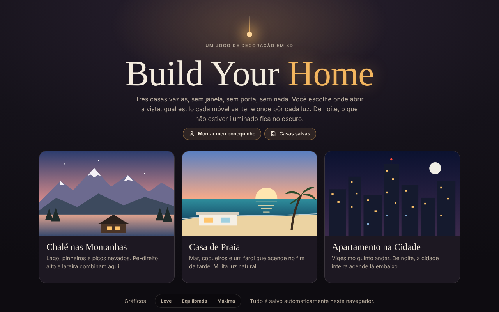

# Build Your Home

Jogo de decoração de interiores em 3D que roda direto no navegador. O jogador escolhe uma casa vazia, abre janelas e portas, mobilia cada cômodo e distribui a iluminação. À noite, só fica visível o que estiver iluminado.

**[Jogar agora](https://olucas-passos.github.io/build-your-home/)**



## Funcionalidades

- Três cenários: chalé nas montanhas, casa de praia e apartamento na cidade
- Catálogo de móveis com cinco estilos de decoração e variações de cor e material
- Ciclo de dia e noite com iluminação dinâmica e sombras em tempo real
- Movimentação em primeira pessoa com teclado e mouse ou controles de toque no celular
- Personalização de avatar, captura de fotos da casa e desfazer (Ctrl + Z)
- Progresso salvo automaticamente no navegador (localStorage)
- Três níveis de qualidade gráfica para rodar bem em computadores mais simples

## Tecnologias

- HTML, CSS e JavaScript puro, sem frameworks
- [Three.js](https://threejs.org/) para a renderização 3D (WebGL 2)
- Layout responsivo para desktop e celular

## Como executar

Não precisa instalar nada. Abra o link acima ou, para rodar localmente:

```bash
git clone https://github.com/oLucas-Passos/build-your-home.git
cd build-your-home
npx serve .
```

Depois acesse `http://localhost:3000`.

## Controles

| Ação | Teclado |
|---|---|
| Andar | W A S D ou setas |
| Abrir catálogo | Tab ou B |
| Girar móvel | R ou rodinha do mouse |
| Alternar noite | N |
| Tirar foto | P |
| Desfazer | Ctrl + Z |

## Autor

Lucas Passos · [GitHub](https://github.com/oLucas-Passos)
